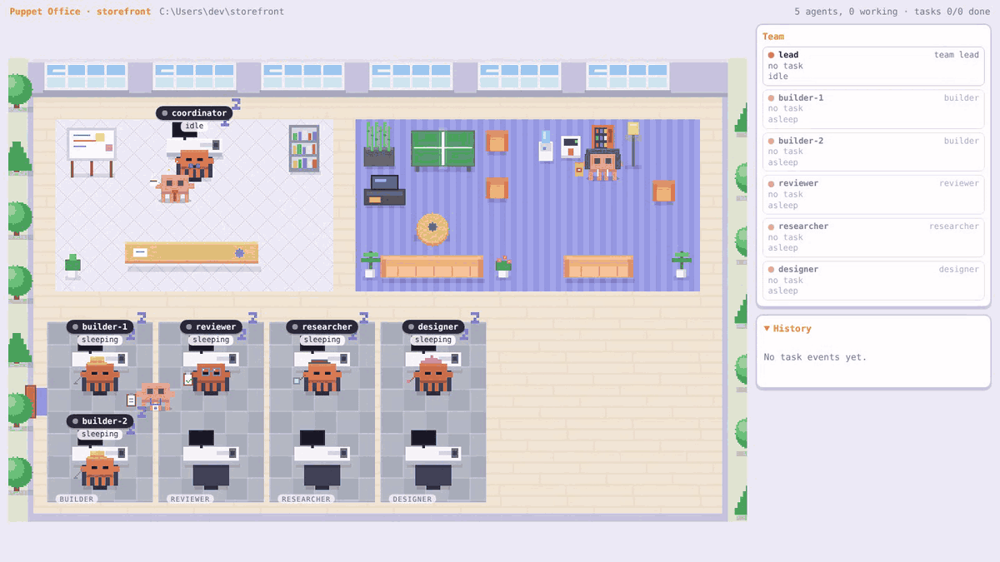
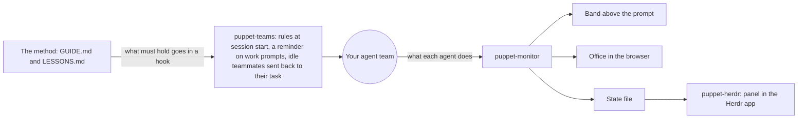
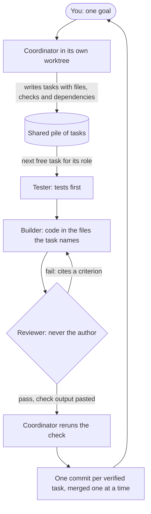
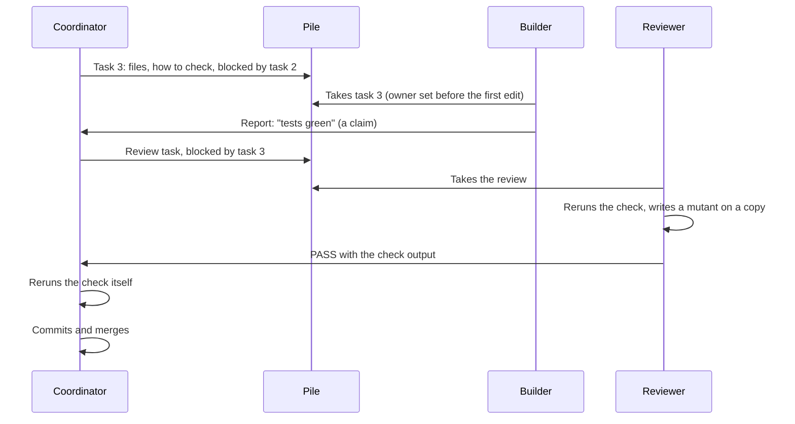
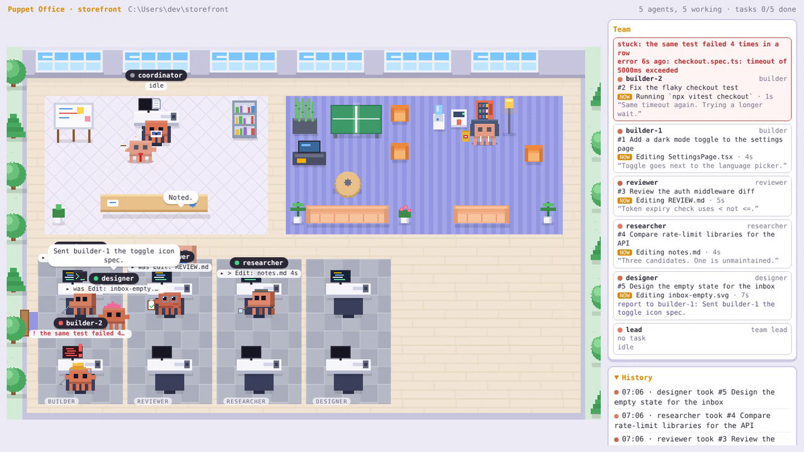
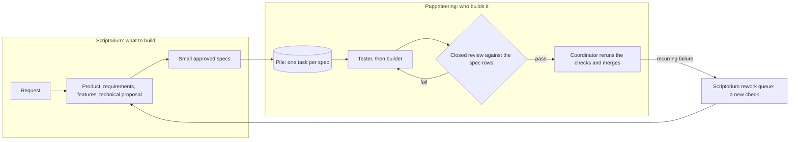

# Puppeteering

**Run a team of Claude Code agents on real work, and still know what they built.**

A field guide for leading a team of agents, and plugins that enforce its rules and show the team at work. One coordinator per goal. A shared pile of tasks. Review by someone who did not write the code. Every claim backed by a check.

<p align="center">
  
</p>
<p align="center"><sub>What the <code>puppet-monitor</code> plugin shows: every agent, its task, what it is running right now, and who is stuck.</sub></p>

<p align="center">
  <a href="#quick-start">Quick start</a> ·
  <a href="ONBOARDING.md">Onboarding</a> ·
  <a href="GUIDE.md">Guide</a> ·
  <a href="LESSONS.md">Lessons</a> ·
  <a href="REFERENCES.md">Official docs</a> ·
  <a href="CONTRIBUTING.md">Contribute</a>
</p>

---

## Why this exists

Starting ten agents takes a minute. Knowing that what they built is right takes all your attention. Claude Code [agent teams](https://code.claude.com/docs/en/agent-teams) give you the machinery; this guide is what running them on a production codebase taught, including what went wrong.

It is opinionated, and it marks what is measured and what is not. It is early: see [what has and has not been run](GUIDE.md#the-pile).

## What you get



| Part | What it does | Where |
| --- | --- | --- |
| **The method** | How one coordinator runs a team: roles, a shared pile of tasks, independent review, every claim checked | [`GUIDE.md`](GUIDE.md), [`LESSONS.md`](LESSONS.md) |
| **puppet-teams** | Gives every session the rules at start, reminds the coordinator to fill the pile before it spawns anyone, and sends an idle teammate back to its open task | [`mods/puppet-teams/`](mods/puppet-teams) |
| **puppet-monitor** | A band above the prompt and an office in the browser that show what every agent is doing, and what is stuck | [`mods/puppet-monitor/`](mods/puppet-monitor) |
| **puppet-herdr** | The same tasks and alerts as a read-only panel in the Herdr desktop app | [`mods/puppet-herdr/`](mods/puppet-herdr) |

## How a team run works

You give one goal to one coordinator. It writes the tasks; teammates take them; a reviewer who did not write the code checks them; the coordinator reruns the check before it merges.



One task, from the pile to the merge:



The monitor watches all of this from outside the coordinator's conversation, so you never have to ask it what everyone is doing:

<p align="center">
  
</p>

| Alert | Means |
| --- | --- |
| `LOOPING` | The same call, with the same arguments, 3 times or more in a row |
| `STUCK` | One call has run for 5 minutes |
| `QUIET` | Working, with no activity for 2 minutes |

## Quick start

**1. Turn on agent teams.** Merge [`setup/settings.json`](setup/settings.json) into `~/.claude/settings.json`:

```json
{
  "env": {
    "CLAUDE_CODE_EXPERIMENTAL_AGENT_TEAMS": "1",
    "CLAUDE_CODE_ENABLE_TODO_TOOLS": "1"
  }
}
```

The first turns teams on. The second is [one way](https://code.claude.com/docs/en/tools-reference#task-tool-availability) to get the shared task list on models newer than Opus 4.7, Sonnet 4.6 and Haiku 4.5, which leave it out by default. With only the first, teammates coordinate by message, with no shared list.

**2. Install the plugins.** In Claude Code, one prompt each:

```
/plugin marketplace add antonygiomarxdev/puppeteering
/plugin install puppet-teams@puppeteering
/plugin install puppet-monitor@puppeteering
```

A band above the prompt then counts your agents, with an **Office** button. The Herdr panel installs with `node mods/puppet-herdr/install.js` from a clone ([details](mods/puppet-herdr)).

**3. Point your sessions at the guide.** Clone this repo, and add this to `~/.claude/CLAUDE.md`:

```markdown
## Agent teams

Before leading a team, read `~/dev/puppeteering/ONBOARDING.md`, then `~/dev/puppeteering/GUIDE.md`.
A project's own document holds only what is specific to it.
```

**4. Ask for a team.** In a session, describe the work and the teammates. Press `Ctrl+T` to watch the task list, or **Office** to watch the team.

## The idea in five rules

1. **One coordinator per goal.** Each goal gets its own coordinator in its own worktree, and that coordinator finishes it. Inside, a pile, not a chain of orders: the coordinator writes tasks with their dependencies; teammates take the next free one.
2. **Parallel by default, serial where it has to be.** Writing and reviewing scale. Your attention and your merges do not.
3. **A report is a claim.** Read the command and its output, then run the check again.
4. **Whoever wrote it does not review it.** A session that did not watch the code being written is not swayed by the reasoning behind it.
5. **What must hold goes in a hook.** A line in a document is advice. A hook runs every time.

## Words used here

| Word | Means |
| --- | --- |
| **Coordinator** (the docs say *team lead*) | The session you give a goal to. It splits the goal, writes tasks, verifies and commits. It does not do the teammates' work |
| **Teammate** | A session the coordinator starts, with one role: tester, builder, reviewer, researcher or ops |
| **Pile** | The shared task list. Each task carries its brief, its files and how it is checked |
| **Band** | The line puppet-monitor draws above the prompt: how many agents, and any alert |
| **Office** | The page in the browser where each agent is a critter at its desk |

## With Scriptorium: what to build, then who builds it

Puppeteering runs a team. It does not decide what the team builds. [Scriptorium](https://github.com/antonygiomarxdev/scriptorium) does: a checked chain of documents, from the product down to small approved specs. Each approved spec is one task on the pile.



| Scriptorium gives | Puppeteering uses it as |
| --- | --- |
| A small spec: rows quoted from its parent, at most 3 files, one done command | One task on the pile, handed as a path |
| Acceptance rows | The tester's tests and the reviewer's only criteria |
| Checks run by script | "A report is a claim": the check everyone reruns |
| The rework queue | Where a lesson becomes a check |

Each works alone. Google's [Harness²](https://github.com/google-research/harness2) improves an agent with two editors kept apart, one for how the agent works and one for what a practitioner knows. Puppeteering is the first lens; Scriptorium is the second. This repo writes its own documents with Scriptorium ([`docs/`](docs)).

## What's inside

| File | What it is |
| --- | --- |
| [`ONBOARDING.md`](ONBOARDING.md) | Start here: setup, leading a team, reading the office, working on this repo |
| [`GUIDE.md`](GUIDE.md) | The way of working: setup, roles, the pile, review, gates, cost and limits |
| [`LESSONS.md`](LESSONS.md) | What failed in real runs, and what changed because of it |
| [`REFERENCES.md`](REFERENCES.md) | The official Claude Code docs for each topic, and further reading |
| [`setup/`](setup) | The settings to copy |
| [`mods/`](mods) | The plugins: puppet-teams, puppet-monitor, puppet-herdr |
| [`office-app/`](office-app) | The source of the office page |
| [`docs/`](docs) | This repo's own product documents, in the Scriptorium chain |

## Contributing

Run it on your own project and tell us what happened: that is the most useful thing you can bring. A rule that failed you, with what you ran, is worth more than a new rule. Start with [`CONTRIBUTING.md`](CONTRIBUTING.md).

## About the name

Puppeteering is one of Neferpitou's Nen abilities in *Hunter x Hunter*: moving many bodies at once. This project is an unofficial, independent guide. It is not affiliated with Anthropic, or with the creators of *Hunter x Hunter*. The artwork here is original, and shows no character from the series.

The idea of animating a team at work came from [a post by @hayatomaruu](https://x.com/hayatomaruu/status/2117739581625802835).

## License

[MIT](LICENSE).
