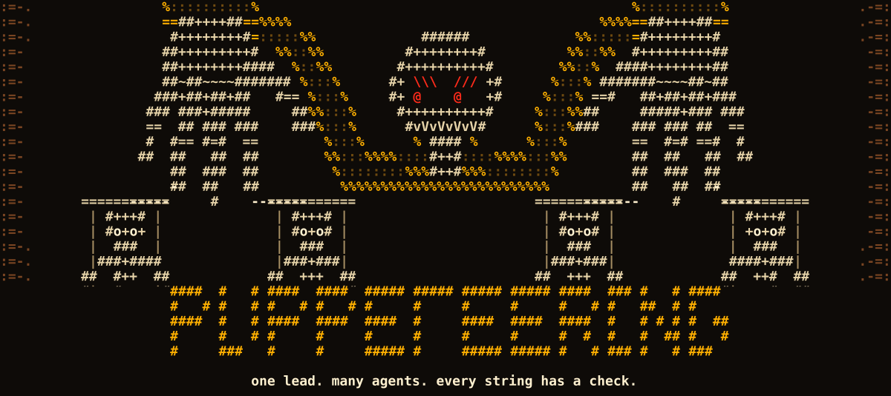

<p align="center">
  
</p>

<p align="center">
  <strong>A field guide to running a team of Claude Code agents on real work.</strong><br>
  One lead. A shared pile of tasks. Independent review. Every claim backed by a check.
</p>

<p align="center">
  <a href="GUIDE.md">Guide</a> ·
  <a href="LESSONS.md">Lessons</a> ·
  <a href="REFERENCES.md">Official docs</a> ·
  <a href="CONTRIBUTING.md">Contribute</a>
</p>

---

<p align="center">
  
</p>

## Why this exists

Starting ten agents takes a minute. Knowing that what they built is right takes all your attention. Claude Code [agent teams](https://code.claude.com/docs/en/agent-teams) give you the machinery; this guide is what running them on a production codebase taught, including what went wrong.

It is opinionated, and it marks what is measured and what is not. It is early: see [what has and has not been run](GUIDE.md#the-pile).

## Quick start

**1. Turn it on.** Merge [`setup/settings.json`](setup/settings.json) into `~/.claude/settings.json`:

```json
{
  "env": {
    "CLAUDE_CODE_EXPERIMENTAL_AGENT_TEAMS": "1",
    "CLAUDE_CODE_ENABLE_TODO_TOOLS": "1"
  }
}
```

You need both. The first turns teams on. The second gives you the shared task list on newer models, which leave it out by default. With only the first, you get something that looks like a team and works like subagents.

**2. Point your sessions at the guide.** Clone this repo, and add this to `~/.claude/CLAUDE.md`:

```markdown
## Agent teams

Before leading a team, read `~/dev/puppeteering/GUIDE.md`.
A project's own document holds only what is specific to it.
```

**3. Ask for a team.** In a session, describe the work and the teammates. Press `Ctrl+T` to watch the task list.

## The idea in five rules

1. **A pile, not a chain of orders.** The lead writes tasks with their dependencies; teammates take the next free one.
2. **Parallel by default, serial where it has to be.** Writing and reviewing scale. Your attention and your merges do not.
3. **A report is a claim.** Read the command and its output, then run the check again.
4. **Whoever wrote it does not review it.** A session that did not watch the code being written is not swayed by the reasoning behind it.
5. **What must hold goes in a hook.** A line in a document is advice. A hook runs every time.

## What's inside

| File | What it is |
| --- | --- |
| [`GUIDE.md`](GUIDE.md) | The way of working: setup, roles, the pile, review, gates, cost and limits |
| [`LESSONS.md`](LESSONS.md) | What failed in real runs, and what changed because of it |
| [`REFERENCES.md`](REFERENCES.md) | The official Claude Code docs for each topic, and further reading |
| [`setup/`](setup) | The settings to copy |

## Contributing

Run it on your own project and tell us what happened: that is the most useful thing you can bring. A rule that failed you, with what you ran, is worth more than a new rule. Start with [`CONTRIBUTING.md`](CONTRIBUTING.md).

## About the name

Puppeteering is one of Neferpitou's Nen abilities in *Hunter x Hunter*: moving many bodies at once. This project is an unofficial, independent guide. It is not affiliated with Anthropic, or with the creators of *Hunter x Hunter*. The artwork here is original.

The animation's idea of showing a team as a live panel was inspired by [a post by @hayatomaruu](https://x.com/hayatomaruu/status/2117739581625802835). The artwork is our own.

## License

[MIT](LICENSE).
