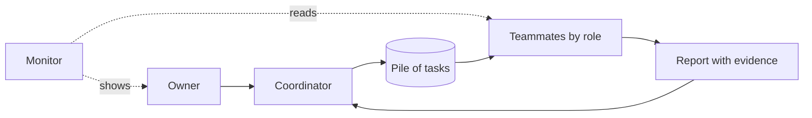

# Puppeteering: product overview

Status: Draft

## Summary

Puppeteering is a field guide and two add-ons for people who run a team of AI coding agents on real work. It starts on Claude Code. It serves the owner who runs a team, the coordinator session that coordinates it, and the teammates who do the work. The rules that matter most: one coordinator per goal and worktree, a shared pile of tasks, a report is a claim until someone reruns the check, and whoever wrote it does not review it. What must hold is enforced by a rule the machine runs, not by a line of advice.

Last change: 2026-11-20, adopted into the chain as a draft; lessons cited by line

Decisions not yet absorbed: [DECISIONS.md](DECISIONS.md). Terms: [GLOSSARY.md](GLOSSARY.md).

## 1. Problem

Starting ten agents takes a minute; knowing that what they built is right takes all of the owner's attention (README, "Why this exists"). Runs of the method in this repo recorded these failures, each in LESSONS.md:

- Three builders on one pile built the same task twice three times, because the owner was set late ([archived lesson, "2026-11: several builders of one role duplicate work"](retro/lessons/2026-11.md#2026-11-several-builders-of-one-role-duplicate-work)).
- A change to a task already marked done was lost: the builder answered "task 9 is already done" ([LESSONS.md, "2026-11: a change to a finished task needs a new task"](../LESSONS.md#2026-11-a-change-to-a-finished-task-needs-a-new-task), a lesson from another session).
- Five times an assignment crossed the teammate's idle notice and the teammate said "already done" about the previous task ([LESSONS.md, "2026-11: a change to a finished task needs a new task"](../LESSONS.md#2026-11-a-change-to-a-finished-task-needs-a-new-task), a lesson from another session).
- Both review rounds failed work that had 48 to 52 passing tests: promised checks that did not exist, and a stop rule that could loop ([LESSONS.md, "2026-11: a change to a finished task needs a new task"](../LESSONS.md#2026-11-a-change-to-a-finished-task-needs-a-new-task), a lesson from another session).
- A coordinator called the work ready before the last review report arrived, and a real blocker shipped unreviewed ([LESSONS.md, "2026-11: a change to a finished task needs a new task"](../LESSONS.md#2026-11-a-change-to-a-finished-task-needs-a-new-task), a lesson from another session).
- Fresh sessions received the rules and still did not start a team ([LESSONS.md, "2026-11: sessions got the rules but did not start a team"](../LESSONS.md#2026-11-sessions-got-the-rules-but-did-not-start-a-team)).
- A teammate killed the owner's browser by killing a process by name ([docs/retro/lessons/2026-11.md, "2026-11: a teammate killed the owner's browser"](retro/lessons/2026-11.md#2026-11-a-teammate-killed-the-owners-browser)).
- A resumed coordinator kept running beside its old self, and both led the same pull requests ([LESSONS.md, "2026-11: a resumed lead kept running beside its old self"](../LESSONS.md#2026-11-a-resumed-lead-kept-running-beside-its-old-self), a lesson from another session).
- A task dependency cleared when the blocking task completed, not when its PR merged, so two PRs were built on the wrong base (issue #10, 2026-11-19).
- The owner cannot see what each agent is doing without asking the coordinator (memory note (paraphrase), monitor purpose, 2026-11-18).

Counted from LESSONS.md, the git log and GitHub on 2026-11-20 (D-10):

- 21 lessons in LESSONS.md (19 from main, 2 from another session), each a failure or a change a run forced.
- 74 commits on 4 days (2026-11-05, 18, 19, 20), 6 merged pull requests, 4 issues (3 closed), one field report with 3 collisions in one run.
- Runs that LESSONS counts: a pile of about 40 tasks with 3 builders and 1 reviewer; 15 tasks with 2 builders and 1 reviewer in 2 review rounds; 16 tasks on another project (issue #10); 7 pull requests at once; 9 fresh-session probes (3 + 3 + 3); one conversation with 143 wake-ups and 791 requests.
- Not countable from the repo: the number of sessions and of runs that left no commit. The owner is the only source.

## 2. Product

Puppeteering is one product: a method, with two add-ons (D-11). It runs on Claude Code first and may be extended to other platforms later (D-12); in this version the platform is a fact in section 9, not what the product is.

- **The method.** A written way of working for one coordinator and its teammates (the platform calls the coordinator its team lead): roles, a shared pile of tasks, independent review, checks for every claim. It marks what was measured and what was only observed, and it links the official docs for every topic.
- **The rules that run.** An add-on that gives every session the method at start, reminds a coordinator to fill the pile before it spawns anyone, and sends an idle teammate back to its open task.
- **The monitor.** An add-on that shows, outside the coordinator's conversation, what every agent is doing, since when, on which task, and what is stuck.

## 3. Users

- **Owner:** the person who gives one goal to a coordinator and reads what the team did. Works on Windows, macOS or Linux, in a terminal or in the desktop app.
- **Coordinator:** the session that splits a goal, writes the tasks, assigns, verifies, commits. Reads the method at the start of a session.
- **Teammate:** a builder, reviewer, researcher or ops session that takes the next free task for its role and reports with evidence.

The owner is the only user (D-8). Coordinator and teammate are sessions the owner starts.

## 4. Principles

1. **One coordinator per goal and worktree.** A coordinator owns one thing to finish, splits it and drives it to done. Two coordinators that collide mean the split was wrong. (Owner, 2026-11-18; memory note (paraphrase): hand it one thing to finish completely; it splits the work, coordinates its teammates and drives it to done.)
2. **A pile, not a chain of orders.** Tasks carry their dependencies, and teammates take the next free one.
3. **A report is a claim.** Read the command and its output, then run the check again.
4. **Whoever wrote it does not review it.** A session that did not watch the work is not swayed by the reasoning behind it.
5. **What must hold is enforced.** A line in a document is advice; a rule the machine runs every time is a guarantee. Delete rules that are only preferences.
6. **The coordinator stays free.** It delegates reading, editing, research and long runs by role, and keeps for itself only talking to the owner, tasks, verification and commits.
7. **Evidence over assertion.** Every rule in the method comes from a run or an official source, says which, and says what was not measured.
8. **Know without asking.** The owner can tell what any agent is doing and why without asking the coordinator. Information comes before looks. (Owner, 2026-11-18; memory note (paraphrase): can I tell what an agent is doing and why, without asking the lead?)
9. **Every behaviour fits the owner's OS and surface.** Nothing is done until it is checked on the surfaces it claims, or says which it was not. (Owner, 2026-11-18; memory note (paraphrase): everything built for puppeteering mods must know the OS (Windows, macOS, Linux) and where it runs: the terminal, the desktop app, or another remote surface.)

## 5. Use cases

| ID | Name | Description |
|---|---|---|
| UC-1 | Learn the method | An owner or a session reads the onboarding and guide and knows how to set up and run a team, and what failed before. |
| UC-2 | Start a team from a goal | A coordinator turns one goal into a pile of tasks with owners, dependencies and checks, then starts one standing teammate per role. |
| UC-3 | Get the rules in every session | A session receives the method at start, resume, clear and compaction without the owner pasting anything. |
| UC-4 | Keep teammates on their tasks | A teammate that goes idle with work left is sent back to the right task, and told which task is new. |
| UC-5 | Watch what every agent is doing | The owner sees each agent's task, current action, last words, history and alerts for stuck, looping or quiet, without asking the coordinator. |
| UC-6 | Open the monitor on any surface | The owner opens the monitor from the terminal or the desktop app on any OS, and learns plainly when it could not open. |
| UC-7 | Report what the method got wrong | The owner files a field report or docs mismatch, and the method changes with the run that shows it. |
| UC-8 | Run a team in the desktop app | The owner gets the pile, roles, independent review and the monitor in the desktop app too, not only in the terminal (D-16). |

## 6. Scope

In this version: the written method (guide, onboarding, lessons, references), the rules add-on and the monitor. Platform: Claude Code first (D-12); other platforms are later and out of this version. The desktop app is in (D-16). Out: the demo video, sprite and social drafts (D-7), a coordinator of coordinators (D-6), anything that runs the agents for you (a scheduler or an orchestrator), peer-to-peer coordination between coordinators, general prompting advice, and any claim about a surface or OS that nobody ran.

## 7. Slice map

| Slice | Folder | Covers | Use cases |
|---|---|---|---|
| method | `docs/method/` | The guide, onboarding, lessons, references and contributing | UC-1, UC-2, UC-7, UC-8 |
| teams | `docs/teams/` | The rules add-on: session rules, reminder, idle redirect | UC-3, UC-4 |
| monitor | `docs/monitor/` | The monitor, its band and its office page | UC-5, UC-6 |

## 8. Success criteria

Set by the owner on 2026-11-20 (D-9):

1. A fresh session in any project starts the pile and a team on a multi-step prompt, in 3 of 3 probes. Measured by probe runs; the first three probes in LESSONS did not all pass.
2. No two agents take the same task in a run: no double claim, by two teammates or by two coordinators. Measured per run from the task files and LESSONS.
3. No task is built twice in a run. Measured per run from the task files and the branches.
4. The owner knows what each agent is doing without asking the coordinator. Judged by the owner on a real run with the monitor.

## 9. Constraints and facts

| Fact | Effect | Verified |
|---|---|---|
| Claude Code is the first platform; the product may be extended to others later (D-12) | PRODUCT and FRDs name Claude Code as a fact. Platform-specific rules live in the TP | Owner, 2026-11-20 |
| Agent teams are an experimental feature of Claude Code, switched on by a setting | The method depends on it and can break when it changes | README, "Quick start"; official agent-teams page |
| The official desktop page says: "Agent teams: coordinated teams, where Claude as the team lead assigns tasks to teammates from a shared task list, are available in the CLI, not in Desktop." It points to dynamic workflows for multi-agent work in Desktop | The owner wants the desktop app to work (D-16), so the desktop path cannot rest on agent teams; FRD METHOD-05 says how it does | https://code.claude.com/docs/en/desktop, read 2026-11-20 |
| A teammate does not see the coordinator's conversation | Every task carries its whole brief | GUIDE, "The pile" |
| The desktop app ran named agents as subagents with no task tools (one Windows 11 run) | Consistent with the desktop page above; issue #8 is closed | GUIDE, "In the desktop app"; issue #8 |
| Teams do not isolate teammates' files | Every running task names files no other task writes | GUIDE, "Files and worktrees" |
| A mod receives thinking blocks with empty text | The monitor shows that an agent thinks, not what | ONBOARDING, section 7 |
| Windows drops the query of a file link it opens | The monitor opens a launcher page | monitor README, "Where it runs" |
| Tested on one Claude Code version, and only on Windows | macOS, Linux and split panes are not verified | ONBOARDING, section 1 and 7 |

## 10. Open questions

None open. The owner answered Q-1 to Q-19 on 2026-11-20; each answer is a decision, D-6 to D-24, in the adoption plan. The code-versus-document pass (D-19, task 92) may add Q-n.
